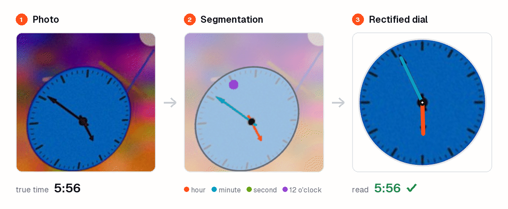
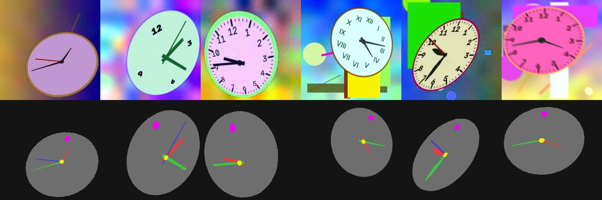
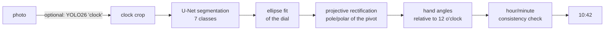
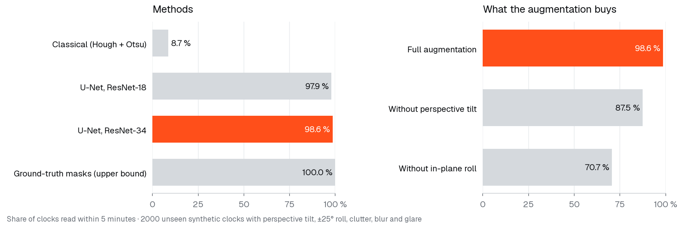

# Analogue clock reader

Reads the time from a photo of an analogue clock. The network never predicts the time. A
U-Net segments the dial, the hands, the pivot and the 12 o'clock position, and projective
geometry turns those masks into hours and minutes. All training data is synthetic: clocks are
rendered procedurally, so every pixel comes with an exact label.


<sub>Unseen tilted and rotated test clocks: the photo, the U-Net masks (hour hand orange, minute
hand blue, 12 o'clock marker purple) and the dial rectified back to a frontal view, with the
hands as the geometry reads them.</sub>


<sub>Rendered training samples (top) and their masks (bottom): dial, hour/minute/second hands,
pivot (yellow) and 12 o'clock marker (magenta).</sub>

## How it works



1. **Dial.** An ellipse is fitted to the dial outline. A circle seen at an angle projects to an
   ellipse.
2. **Rectification.** The centre of a circle is the pole of the line at infinity. The polar of the
   projected pivot with respect to the fitted ellipse is therefore the vanishing line of the
   dial plane. Mapping that line back to infinity, and then the ellipse to the unit circle,
   removes the perspective exactly (up to a rotation).
3. **Orientation.** The remaining rotation comes from the segmented 12 o'clock marker, so rotated
   clocks are read correctly too.
4. **Hands.** Each hand's angle is the r²-weighted mean direction of its pixels. The long tip
   outweighs a counterweight tail.
5. **Consistency.** Minutes come from the minute hand. The hour is the one whose *expected* hour
   hand angle, `(h + m/60)·30°`, best matches the observed hour hand. This removes the typical
   off-by-one-hour error around the full hour (2:58 is not 3:58).

## Results

Synthetic test set (2000 unseen clocks: perspective tilt, ±25° roll, clutter, blur, glare, JPEG)
and the same clocks rendered facing the camera ("flat"). Values are the share of clocks read
within 5 minutes. Trained on a supercomputer (one NVIDIA A100, 40 epochs, about 70 minutes).

| Method | Synthetic | Synthetic, flat |
|---|---|---|
| Ground-truth masks + geometry (upper bound) | 1.000 | 1.000 |
| Classical: Hough circle + Otsu + same geometry | 0.087 | 0.697 |
| **U-Net (ResNet-34) + geometry** | **0.986** | **0.997** |



The network reads 97.6 % of the distorted clocks within one minute, with a median error of
0.1 minutes and no failures. The upper bound shows that the geometric step is exact, so the
remaining error comes from segmentation. The classical pipeline works on clean, frontal clocks
and breaks down under tilt, rotation and clutter - the gap the learned segmentation closes.
Labelled real photos are not collected yet; `clock-eval --real-csv` is ready for them.
The figures come from `python scripts/make_figures.py --checkpoint runs/resnet34_unet/best.pt`.

### Smaller encoder

| Encoder | Parameters | Synthetic | Flat | CPU latency, 1 / 4 threads |
|---|---|---|---|---|
| ResNet-34 | 24.4 M | 0.986 | 0.997 | 75 / 42 ms |
| ResNet-18 | 14.3 M | 0.979 | 0.993 | 70 / 39 ms |

Latency: PyTorch, batch 1, 256 × 256 input, Apple M4 Pro. ResNet-18 loses 0.7 points but is only
7 % faster: at this resolution most of the compute is in the U-Net decoder, not the encoder. The
ResNet-34 model stays the default.

### Ablation: what the geometric augmentation buys

Each model trained without one augmentation, all scored on the same distorted test clocks
(`--test-config configs/resnet34_unet.yaml`; scoring an ablation on its own, easier clocks would
hide the effect):

| Training data | Synthetic | Flat |
|---|---|---|
| Full augmentation | **0.986** | 0.997 |
| without perspective tilt | 0.875 | 0.995 |
| without roll (in-plane rotation) | 0.707 | 0.998 |

Both augmentations are free on frontal clocks and essential on real-looking ones: tilt is worth
11 points, roll 28. Without roll the median error stays at 0.1 minutes while 29 % of the clocks
are read wrongly - the readings that fail, fail completely. That points at a wrong orientation
(which comes from the segmented 12 o'clock marker) rather than imprecise hands.

## Quickstart

```bash
pip install -e ".[train]"
clock-synth --out data/synth_preview --n 32        # look at the training data
clock-train --config configs/resnet34_unet.yaml     # GPU recommended
clock-eval  --checkpoint runs/resnet34_unet/best.pt --n 2000
clock-read  --checkpoint runs/resnet34_unet/best.pt --source photo.jpg
clock-read  --checkpoint runs/resnet34_unet/best.pt --source photos/ --detect   # find clocks with YOLO26 first
python -m clock_reader.export --checkpoint runs/resnet34_unet/best.pt          # ONNX
```

Real photos can be evaluated by listing them in a CSV with columns `path,hour,minute[,second]`
and passing `--real-csv labels.csv` to `clock-eval`.

## Training on a GPU cluster (Slurm)

```bash
bash scripts/setup_cluster.sh                        # once, on a login node
bash scripts/download_models.sh                   # pretrained encoders + YOLO weights
python3 slurm/generate.py --list
python3 slurm/generate.py train-resnet34 --submit
python3 slurm/generate.py ablation-geometry --submit
python3 slurm/generate.py evaluate --submit
python3 slurm/generate.py evaluate-others --submit   # ResNet-18 + ablations on the same test clocks
```

Data needs no download or storage: 16 DataLoader workers render about 1.5k clocks per second,
and each epoch sees 40k new samples. Training resumes automatically after a time-limit stop.

## Project layout

```
src/clock_reader/
  synth.py        procedural renderer: dial/hand styles, numerals, perspective, clutter, photometric noise
  geometry.py     ellipse fit, pole-polar rectification, hand angles, hour/minute consistency
  model.py        timm encoder + U-Net decoder, CE + Dice loss
  data.py         on-the-fly synthetic dataset, labelled real photos
  train.py        training loop; model selection on end-to-end reading accuracy
  classical.py    learning-free baseline
  evaluate.py     network vs. classical vs. oracle, synthetic and real
  predict.py      CLI with optional YOLO clock detection and annotated output
  export.py       ONNX export + parity check
tests/            geometry on ground-truth masks, rectification, classical baseline, end-to-end smoke test
```

## Limitations

- Assumes a single pivot with hour and minute hands; 24-hour dials, mirrored clocks and
  chronograph sub-dials are out of scope.
- The 12 o'clock marker is inferred from appearance (numerals, ticks, logo position). On dials
  with no cues at all, the network can only assume the clock is upright.
- Synthetic-to-real transfer is the main risk. The real-photo column above is the honest
  measure of it.

## References

- Hartley & Zisserman, *Multiple View Geometry in Computer Vision*, ch. 2 (conics, pole-polar) and ch. 8.
- Yang et al., *It's About Time: Analog Clock Reading in the Wild*, CVPR 2022: a learned end-to-end alternative.
- Ronneberger et al., *U-Net*, MICCAI 2015.
